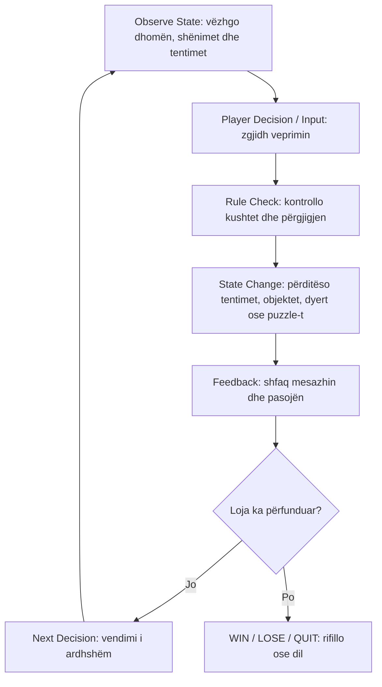
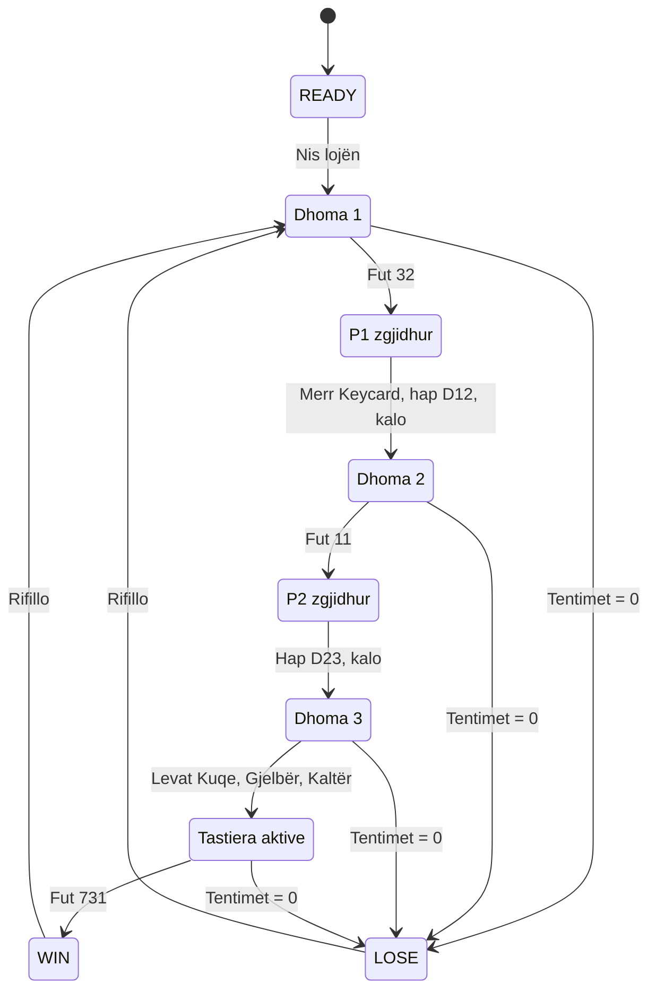

# PBT 3 | Java 4 – Dizajnimi i lojërave

**Faza II – Product Design**  
**Loja:** Escape Room: The Locked Lab  
**Dokumenti:** Game Design Document (GDD) v0.1 – version i kombinuar  
**Lënda:** Zhvillimi i Lojërave

**Ekipi:** Haka Gashi, Anduena Zogaj, Blearta Kodraliu dhe Gent Halabaku.  
**Raportuesi:** Studenti C, sipas rotacionit të ekipit.

## 1. Objektivi i javës

Qëllimi është të përcaktojmë si luhet loja, si ndryshon gjendja dhe si kontrollohen rregullat. Një person jashtë ekipit duhet të mund ta provojë mekanikën duke ndjekur këtë dokument.

Për këtë javë përdorim **prototip në letër**. Loja përfundimtare mbetet e planifikuar në Unity/C#.

Literatura e shënuar në detyrë: Rabin (red.), *Introduction to Game Development*, kapitulli 2.1, Isaac Barry (Game Design).

## 2. Përshkrimi i lojës

Lojtari është i mbyllur në një laborator dhe duhet të kalojë nëpër tri dhoma. Në secilën zgjidh një puzzle dhe hap rrugën përpara. Loja synon një lojtar fillestar ose mesatar dhe ka **5 tentime të përbashkëta, pa timer**.

| Dhoma | Informacioni dhe puzzle | Zgjidhja dhe shpërblimi |
|---|---|---|
| 1 – Hyrja | Shënimi: `2, 4, 8, 16, ?`; çdo numër dyfishohet | `32` zhbllokon dollapin. Lojtari merr kartelën dhe hap derën për dhomën 2 |
| 2 – Kontrolli | Ekrani: `1011`. Shënimi tregon peshat `8, 4, 2, 1` dhe kërkon mbledhjen e peshave me bit 1 | `11` jep shënimin me kodin `731` dhe lejon hapjen e derës për dhomën 3 |
| 3 – Dalja | Shënimi: “E kuqja para së gjelbrës dhe e gjelbra para së kaltrës” | Kuqe → Gjelbër → Kaltër aktivizon tastierën. Kodi `731` hap daljen |

Dalja përdor kodin e gjetur; nuk është puzzle i katërt. Kartela dhe shënimi ruhen në inventory dhe nuk konsumohen. Lojtari mund të kthehet në dhomat e hapura dhe t’i rilexojë shënimet.

## 3. Core gameplay loop



**Shembull:** lojtari lexon vargun, jep `32`, kontrollohet përgjigjja dhe P1 shënohet i zgjidhur. Mesazhi tregon se dollapi u zhbllokua. Vendimi tjetër është marrja e kartelës. Me `31`, humbet një tentim dhe njoftohet se i mbeten 4.

Cikli përsëritet për puzzle-t, objektet dhe dyert deri në përfundim.

## 4. Game state

Këto të dhëna shkruhen në një fletë dhe përditësohen pas çdo veprimi.

| Variabla (tipi) | Vlera fillestare | Vlerat e lejuara dhe kufizimet |
|---|---|---|
| `status` (enum) | `READY` | `READY`, `PLAYING`, `WIN`, `LOSE`, `QUIT` |
| `currentRoom` (int) | `1` | 1–3; kalimi vetëm nëpër dyer të hapura |
| `attempts` (int) | `5` | 0–5; të përbashkëta për gjithë lojën |
| `puzzle1Solved` (bool) | `false` | P1; mbetet `true` deri në rifillim |
| `puzzle2Solved` (bool) | `false` | P2; mbetet `true` deri në rifillim |
| `puzzle3Solved` (bool) | `false` | P3; mbetet `true` deri në rifillim |
| `inventory` (listë) | `[]` | Vetëm `Keycard` dhe `Note731`, pa dublime |
| `door1Open` / `D12` (bool) | `false` | Hapet pas P1 dhe marrjes së `Keycard` |
| `door2Open` / `D23` (bool) | `false` | Hapet pas P2 |
| `exitOpen` (bool) | `false` | Hapet me kodin 731 pasi zgjidhen të tri puzzle-t |
| `leverSequence` (listë) | `[]` | 0–2 leva të ndryshme në pritje të levës së tretë; kontrollohet dhe zbrazet pas levës së tretë |

**Gjendje të derivuara:** `cabinetOpen = puzzle1Solved`; `keypadActive = puzzle3Solved` (pasi P1 dhe P2 janë zgjidhur në rrjedhën normale). Nuk nevojiten variabla të ndara për këto dy kushte.

Dollapi është i zhbllokuar kur P1 është zgjidhur. Tastiera aktivizohet pas zgjidhjes së të tri puzzle-ve. Këto përcaktohen nga fleta e gjendjes.

**Shembull për rikrijimin e situatës:** PLAYING; dhoma 3; 4 tentime; P1 dhe P2 të zgjidhura, P3 jo; inventory me kartelë dhe kodin 731; D12 dhe D23 të hapura; rendi `[Kuqe]`. Lojtari vazhdon me Gjelbër dhe Kaltër. Rendi i pjesshëm duhet ruajtur që situata të rikrijohet saktë.

## 5. Tranzicionet

| Gjendja ose situata | Veprimi dhe kushti | Gjendja pas veprimit |
|---|---|---|
| READY | Nis lojën | PLAYING, dhoma 1, 5 tentime |
| PLAYING, dhoma 1 | Zgjidh P1 dhe merr kartelën | Mund të hapë D12 dhe të kalojë në dhomën 2 |
| PLAYING, dhoma 2 | Zgjidh P2 | Merr shënimin 731; mund të hapë D23 dhe të kalojë në dhomën 3 |
| PLAYING, dhoma 3 | Aktivizon levat në rendin e saktë | P3 zgjidhet dhe tastiera aktivizohet |
| PLAYING, mbi 1 tentim | Jep përgjigje të gabuar | Mbetet PLAYING, tentimet ulen me 1 |
| PLAYING, 1 tentim | Jep përgjigje të gabuar | LOSE, 0 tentime |
| PLAYING, tastiera aktive | Jep kodin 731 | Dalja hapet; WIN |
| PLAYING | Kthehet në dhomë fqinje me derë të hapur | Ndryshon vetëm dhoma; progresi ruhet |
| READY ose PLAYING | Zgjedh të dalë nga loja | QUIT, pa fitore |
| Çdo status | Zgjedh rifillimin | PLAYING me të gjitha vlerat fillestare, përveç statusit |

### Diagrami i tranzicioneve

Diagrami paraqet rrugën kryesore drejt fitores dhe humbjen kur tentimet shkojnë në zero. Tabela më sipër përfshin edhe kthimin pas, rifillimin dhe daljen nga loja.



## 6. Rregullat WHEN dhe IF THEN

Veprimet e lojës kërkojnë PLAYING. Përjashtim janë nisja, rifillimi dhe mbyllja. Një veprim i refuzuar jep arsyen dhe nuk ndryshon gjendjen.

| ID | WHEN / IF | THEN dhe pasoja | Feedback |
|---|---|---|---|
| R1 | WHEN nis lojën, IF statusi është READY | THEN statusi bëhet PLAYING | “Loja nisi. Ke 5 tentime” |
| R2 | WHEN lexon shënimin ose shikon inventory-n | THEN merr informacion pa ndryshim të gjendjes | Shënimi i dhomës ose objektet e mbledhura |
| R3 | WHEN përgjigjet saktë në terminalin e dhomës aktuale, IF puzzle është i pazgjidhur | THEN P1 zhbllokon dollapin; P2 jep shënimin 731 | “Puzzle u zgjidh” dhe shpërblimi |
| R4 | WHEN përgjigjja ka format të vlefshëm, IF është e gabuar | THEN tentime −1; në 0 → LOSE | “Përgjigje e gabuar. Të mbeten N tentime” ose “LOSE” |
| R5 | WHEN fusha është bosh ose formati është i pavlefshëm | THEN nuk humbet tentim dhe nuk merr progres | “Shkruaj 2 shifra në terminal ose 3 te dalja” |
| R6 | WHEN kërkon kartelën, IF është në dhomën 1 dhe P1 është zgjidhur | THEN kartela shtohet një herë; pa kushtet kërkesa refuzohet | “Kartela u mor” ose “Zgjidh fillimisht terminalin” |
| R7 | WHEN hap derën pranë tij, IF D12 ka P1 dhe kartelën, ose D23 ka P2 | THEN dera hapet; pa kushtet mbetet e mbyllur | “Dera u hap” ose kushti që mungon |
| R8 | WHEN lëviz, IF dhoma është fqinje dhe dera është e hapur | THEN ndryshon vetëm dhoma; përndryshe refuzohet | “Hyre në dhomën…” ose “Kalimi është i bllokuar” |
| R9 | WHEN përdor levë në dhomën 3, IF P3 është i pazgjidhur | THEN shtohet në rend. Pas tri levave: rendi i saktë zgjidh P3; i gabuari heq vetëm 1 tentim. Rendi pastaj zbrazet | Rendi aktual; pastaj “Tastiera u aktivizua” ose “Rend i gabuar; provo përsëri” |
| R10 | WHEN përsërit levë në të njëjtën provë ose kërkon objekt jashtë dhomës | THEN veprimi refuzohet pa penalizim | “Kjo levë është zgjedhur” ose “Objekti nuk gjendet këtu” |
| R11 | WHEN përsërit puzzle të zgjidhur, merr kartelë të mbledhur ose hap derë të hapur | THEN pa shpërblim tjetër dhe pa penalizim | “Ky veprim është përfunduar” |
| R12 | WHEN jep 731 te dalja, IF është në dhomën 3, të tri puzzle-t janë zgjidhur dhe ka shënimin | THEN dalja hapet dhe bëhet WIN. Pa kushtet kodi nuk vlerësohet; me kushte por kod të gabuar zbatohet R4 | “Dole nga laboratori!” ose kushti që mungon |
| R13 | WHEN tentimet bëhen 0 ose statusi është WIN, LOSE apo QUIT | THEN gameplay bllokohet; lejohen vetëm rifillimi ose mbyllja | Rezultati përfundimtar dhe zgjedhjet |
| R14 | WHEN zgjedh rifillimin ose daljen | THEN rifillimi rivendos gjithçka; dalja nga sesioni aktiv jep QUIT | “Loja rifilloi” ose “Loja u mbyll” |

**Formati:** terminalet pranojnë saktësisht 2 shifra, dalja 3 shifra. `31` është përgjigje e gabuar që kushton një tentim. `abc`, bosh ose `032` në terminal janë format i pavlefshëm dhe nuk penalizohen. Hapësirat anësore hiqen.

Levat kontrollohen pas tri levave të ndryshme. Rendi i pjesshëm ruhet edhe gjatë largimit nga dhoma. Kalimi lejohet vetëm mes fqinjëve: `1 ↔ 2 ↔ 3`.

## 7. Fitore, humbje dhe rastet kufitare

- **WIN:** të tri puzzle-t zgjidhen dhe dalja hapet me 731, me të paktën 1 tentim.
- **LOSE:** një përgjigje e gabuar ose renditje e plotë e gabuar e levave i çon tentimet në 0.
- **QUIT:** lojtari ndërpret sesionin pa fitore. Mbyllja pas WIN/LOSE ruan rezultatin ekzistues.
- Përgjigjja e saktë në tentimin e fundit lejohet dhe nuk konsumon tentim.
- Pas LOSE nuk pranohet përgjigje e vonuar për ta ndryshuar rezultatin.
- Prova e daljes para zgjidhjes së levave refuzohet pa penalizim.
- Rifillimi kthen dhomën 1, 5 tentime, puzzle-t Jo, inventory-n bosh, dyert të mbyllura dhe rendin e levave bosh.

## 8. Prototipi në letër

**Materiali për printim:** [Prototipi në letër (PDF)](output/pdf/Prototipi_ne_Leter.pdf). **Kontrolloni që PDF-ja të jetë vendosur në këtë rrugë në repository përpara dorëzimit.**

Printoni 7 faqet në format A4, vetëm në njërën anë, në madhësinë 100%. Faqja 1 ka udhëzimet dhe përgjigjet për moderatorin; faqet 2–4 janë dhomat; faqja 5 ka kartelat për prerje; faqja 6 është fleta e gjendjes; faqja 7 është formulari i playtest-it. Moderatori mban të fshehura faqet 1 dhe 5 gjatë përgatitjes dhe i jep lojtarit objektet vetëm pasi plotësohen kushtet.

### Materialet

Tri fletë për dhomat, një fletë për game state, një kartelë prej letre, një shënim me 731, tri letra me emrat e levave dhe pesë shenja për tentimet. Një person luan; një tjetër është moderatori që kontrollon rregullat.

```text
[Dhoma 1] ── D12 ── [Dhoma 2] ── D23 ── [Dhoma 3] ── Dalja
 Shënimi             Ekrani binar         Shënimi i rendit
 Terminali           Tabela e peshave     Tri levat
 Dollapi/kartela      Terminali           Tastiera finale
```

Në secilën fletë shkruhen objektet dhe shënimet nga pjesa 2. Kartela mbahet e mbuluar në dollap; letrën me 731 e mban moderatori deri në zgjidhjen e P2. Në dyer shkruhet “Mbyllur”. Zgjidhjet i mban moderatori dhe nuk ia tregon lojtarit paraprakisht.

### Hapat e lojës

1. Moderatori kopjon vlerat fillestare nga pjesa 4 në fletën e gjendjes dhe vendos pesë shenjat e tentimeve.
2. Lojtarit i thuhet: “Dil nga laboratori. Ke 5 tentime dhe nuk ka timer. Mund të lexosh, të japësh përgjigje, të marrësh objekte dhe të hapësh dyer”.
3. Pas nisjes, lojtari shikon dhomën aktuale dhe zgjedh një veprim. Moderatori kontrollon rregullin, përditëson fletën dhe thotë feedback-un.
4. Objektet e marra vendosen në inventory. Dera shënohet “Hapur” pasi plotësohen kushtet; kalimi në dhomën tjetër është veprim më vete.
5. Për levat, lojtari rendit letrat. Pas së tretës moderatori kontrollon rendin, e regjistron pasojën dhe i rivendos letrat. Rendi i gabuar largon vetëm një shenjë tentimi.
6. Cikli vazhdon deri në WIN, LOSE ose QUIT. Rifillimi rivendos të gjitha letrat dhe vlerat fillestare.

**Rruga e pritshme e fitores për moderatorin:** `32` → merr kartelën → hap D12 → kalo në dhomën 2 → `11` → merr shënimin 731 → hap D23 → kalo në dhomën 3 → Kuqe, Gjelbër, Kaltër → `731` → WIN. Ky është shembull i pritshëm, jo playtest i kryer.

## 9. Rastet e testimit

Këto janë **rezultate të pritshme për testim manual**. Nuk deklarohen si të ekzekutuara. “Dhoma 2” nënkupton P1 të zgjidhur, kartelën dhe D12 të hapur. “Dhoma 3” nënkupton edhe P2 të zgjidhur, shënimin 731 dhe D23 të hapur. Përveç rasteve ku thuhet ndryshe, statusi është PLAYING dhe ka 5 tentime.

| Testi | Gjendja dhe inputi | Rezultati i pritshëm | Rregullat |
|---|---|---|---|
| T1 – Nisje dhe lexim | READY; nis lojën, lexo shënimin, shiko inventory-n | PLAYING, dhoma 1, 5 tentime; leximi nuk ndryshon gjendjen, inventory bosh | R1, R2 |
| T2 – Veprim normal | Dhoma 1; jep 32, merr kartelën, hap D12 dhe kalo në dhomën 2 | P1 zgjidhet, kartela ruhet, D12 hapet; dhoma bëhet 2 | R3, R6–R8 |
| T3 – Progres normal | Dhoma 2; jep 11, hap D23 dhe kalo në dhomën 3 | P2 zgjidhet, shënimi 731 merret, D23 hapet; dhoma bëhet 3 | R3, R7, R8 |
| T4 – Përgjigje e gabuar | Dhoma 1; jep 31 | 4 tentime, P1 ende i pazgjidhur; shfaqet pasoja | R4 |
| T5 – Input i pavlefshëm | Dhoma 1; jep bosh, abc dhe 032 | Secili refuzohet; 5 tentime dhe pa progres | R5 |
| T6 – Kushte të paplotësuara | Dhoma 1 me P1 të pazgjidhur: kërko kartelën, hap D12, provo kalim në dhomën 2. Veçmas, dhoma 3 me P3 të pazgjidhur: provo 731 | Të gjitha refuzohen pa penalizim dhe tregojnë kushtin që mungon | R6–R8, R12 |
| T7 – Levat | Dhoma 3; Kaltër, Kuqe, Gjelbër; pastaj Kuqe, Kuqe, Gjelbër, Kaltër | Rendi i parë heq 1 tentim dhe zbrazet; Kuqe e përsëritur refuzohet; rendi i dytë zgjidh P3 me 4 tentime | R9, R10 |
| T8 – Përsëritje dhe kthim | Dhoma 3 me P3 të zgjidhur: provo levat përsëri. Kthehu në dhomën 1, përsërit P1, marrjen e kartelës dhe hapjen e D12; kërko levë këtu | Pa shpërblime të dyfishta ose penalizim; leva jashtë dhomës refuzohet; progresi ruhet | R8, R10, R11 |
| T9 – Fitore në kufi | Dhoma 3, të tri puzzle-t të zgjidhura, shënimi 731 dhe 1 tentim; jep 731, pastaj provo lëvizje | WIN me 1 tentim; dalja hapet dhe gameplay bllokohet | R12, R13 |
| T10 – Humbje në kufi | Dhoma 1, P1 i pazgjidhur, 1 tentim; jep 31, pastaj 32 | LOSE me 0; përgjigjja e vonuar nuk e ndryshon rezultatin | R4, R13 |
| T11 – Kodi final | Dhoma 3 me tastierë aktive; jep abc, pastaj 730 | abc nuk penalizohet; 730 heq 1 tentim dhe dalja mbetet e mbyllur | R4, R5, R12 |
| T12 – Rifillim dhe dalje | Veçmas pas progresit, WIN dhe LOSE: rifillo; pastaj dil nga sesioni aktiv | Rifillimi kthen dhomën 1, 5 tentime, puzzle Jo dhe lista bosh; dalja jep QUIT | R14 |

## 10. Playtest me një ekip tjetër

**Statusi: në pritje të kryerjes.** Një anëtar nga një ekip tjetër duhet ta luajë prototipin pa i ditur zgjidhjet. Moderatori regjistron veprimet, vështirësitë dhe ndihmën e dhënë. Provohen rrjedha e lojës, një përgjigje e gabuar dhe një input i pavlefshëm.

Pas sesionit plotësohet shënimi me të dhëna reale:

| Fusha | Plotësimi |
|---|---|
| Data, ekipi tjetër dhe testuesi | Për t’u plotësuar |
| Rezultati dhe tentimet e mbetura | Për t’u plotësuar |
| Veprimi konkret dhe çfarë ndodhi | Për t’u plotësuar |
| Evidenca: rendi i veprimeve ose fotografia e fletës së gjendjes | Për t’u plotësuar |
| Problem, përmirësim ose konfirmim i vëzhguar | Për t’u plotësuar |
| Ndryshimi i propozuar dhe arsyeja | Për t’u plotësuar |
| Rezultati pas riprovës | Për t’u plotësuar |

Regjistrohet të paktën një gjetje me evidencë. Nëse testuesi ngec, shënohet ku dhe pas cilit mesazh. Nëse një rregull kuptohet pa ndihmë, shënohet veprimi që e konfirmon. Konfirmimi mund të arsyetojë ruajtjen e rregullit pa ndryshim.

## 11. Raporti 3-minutësh i javës

**1. Sprint goal:** Këtë javë qëllimi ishte ta kthenim idenë e Escape Room në një specifikim të qartë. Përcaktuam ciklin e lojës, gjendjet, tranzicionet dhe rregullat që tregojnë çfarë ndodh pas çdo veprimi. Ruajtëm tri dhomat, tri puzzle-t dhe pesë tentime pa timer.

**2. Çfarë u përfundua:** Përgatitëm GDD v0.1, diagramin e gameplay loop, tabelën e gjendjeve dhe rregullat WHEN/IF–THEN. Përgatitëm përmbajtjen dhe udhëzimet e prototipit në letër, si dhe 12 raste testimi me rezultate të pritshme. Prototipi mund të provohet me një lojtar dhe një moderator.

**3. Evidenca në repo:** Dokumenti i kombinuar është `GDD_v0.1_Final.md` (vendoseni në folderin PBT3 në repository). Brenda tij janë përshkrimet e dhomave, fleta e gjendjes, kushtet e dyerve dhe udhëzimet për vendosjen e letrave. Tabela e testeve mbulon veprimet normale, inputet e pavlefshme dhe rastet kufitare. Rezultatet reale të playtest-it do të shtohen pas sesionit.

**4. Një problem real:** Gjatë hartimit vërejtëm se duhej të ruanim edhe rendin e pjesshëm të levave. Vetëm dhoma dhe numri i puzzle-ve nuk tregonin cilën levë kishte zgjedhur lojtari. E shtuam në game state dhe përcaktuam kur ruhet e kur zbrazet, në mënyrë që situata të rikrijohet saktë.

**5. Çfarë mësuam:** Mësuam se çdo rregull duhet të ketë një kusht, një pasojë dhe feedback. Për shembull, një përgjigje numerike e gabuar humbet tentim, ndërsa një fushë bosh kërkon korrigjim pa penalizim. Kjo e bën sjelljen të kuptueshme për lojtarin dhe të testueshme për ekipin.

**6. Blocker/risk:** Duhet të organizojmë playtest-in me një ekip tjetër. Pa këtë provë nuk mund të konfirmojmë nëse një lojtar i ri i kupton shënimet dhe hapin e ardhshëm. Formulari është gati, por ky kriter mbetet i hapur. Rreziku kryesor është konfuzioni nga udhëzimet.

**7. Objektivi i javës tjetër:** Të kryejmë playtest-in, të regjistrojmë një gjetje me evidencë dhe të përmirësojmë rregullin ose mesazhin përkatës. Pastaj do ta përdorim këtë dizajn për implementimin në Unity/C#, duke nisur me terminalin, kartelën dhe derën e dhomës së parë.

Raportuesi duhet të mund të shpjegojë ku ruhet progresi, kur hiqet tentimi, pse hapet secila derë, si kontrollohen levat dhe kur loja përfundon.

## 12. Kontrolli i kërkesave

| Kërkesa nga detyra | Ku mbulohet |
|---|---|
| GDD v0.1 dhe core gameplay loop | Pjesët 1–3 |
| Variablat, fillimi, kufizimet dhe tranzicionet | Pjesët 4–5 dhe diagrami Mermaid |
| Rregullat e testueshme, pasojat dhe feedback-u | Pjesa 6 dhe lidhja me testet te pjesa 9 |
| Win/loss/termination dhe rastet kufitare | Pjesa 7 |
| Paper prototype ose simulim | Prototipi në letër te pjesa 8 |
| Të paktën 5 raste testimi | 12 raste te pjesa 9 |
| Playtest me ekip tjetër dhe evidenca | Pjesa 10; duhet kryer dhe plotësuar |
| Raporti me shtatë pikat e detyrueshme | Pjesa 11 |

Dokumentacioni dhe udhëzimet janë përgatitur. Për plotësimin e Definition of Done mbetet prova reale me një ekip tjetër dhe regjistrimi i feedback-ut të tij.
